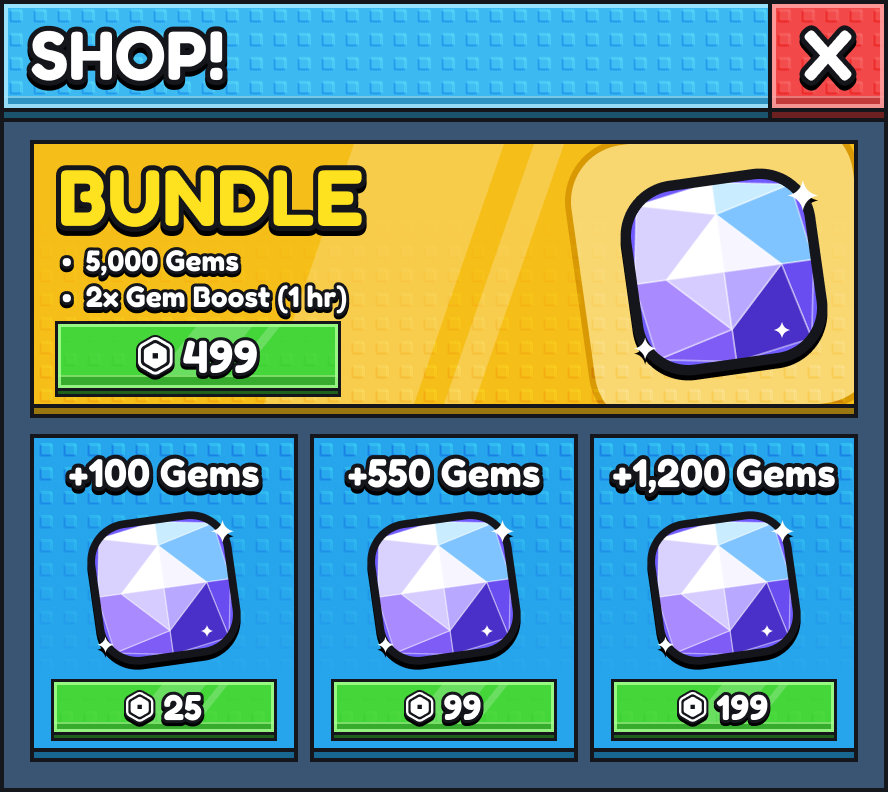
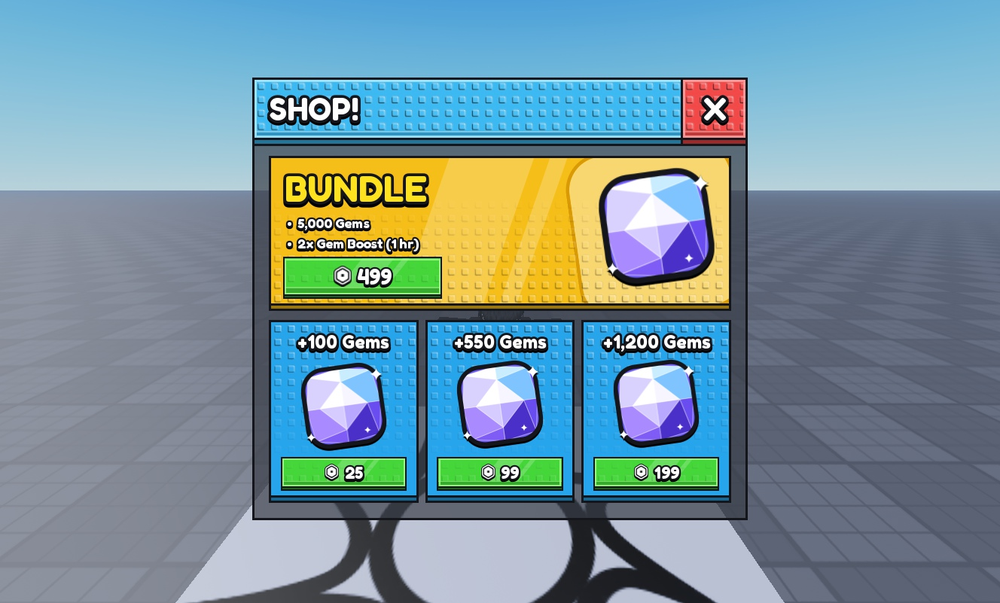

# ui-figma-roblox

An agent skill for designing **Roblox stud-style UI in Figma** — layered panels, tiled stud textures, product cards, icons, button systems, currency displays — with a bundled art library and a verified Figma → Roblox `StarterGui` worked example.



## What it does

- Builds complete Roblox interfaces (shops, HUDs, menus) in Figma from layered, editable shapes.
- Encodes a reusable visual language: gradients, hard shadows, extruded depth, outlines, stud tiling, sheen, and button states.
- Ships **1,081 bundled art assets** (stud tiles, halftones, rays, sparkles, chains, backgrounds, renders, textures, faces, icons, UI sounds).
- Includes worked Figma scripts, a Roblox `ScreenGui` builder, and hard-won notes on porting Figma effects to Roblox.
- Keeps you honest about deliverable claims: mockup vs. exported assets vs. verified Studio implementation.

## Quick start

### Requirements

- An agent that supports **Agent Skills** (Claude Code, Claude.ai skills, opencode, etc.).
- A **Figma MCP server** connected to your agent if you want the skill to build in Figma.
  When the Figma MCP is available, load the `figma:figma-use` skill before any `use_figma` call (and `figma:figma-generate-design` for full screens).
- Optional: **Roblox Studio MCP** for the Figma → Roblox port.

### Install

Clone into your personal skills directory:

```bash
git clone https://github.com/grim-technologies-arch/ui-figma-roblox.git ~/.claude/skills/ui-figma-roblox
```

Or vendor it into a project with `.claude/skills/ui-figma-roblox/`.

For other agents, clone it into that agent's skills folder (for example `~/.config/opencode/skills/ui-figma-roblox/`).

### Use it

Ask for a design in your own words:

```text
Design a stud-style shop screen for my mining game in Figma.
Match the panel, header, card and button style in examples/stud-shop.
```

```text
Build a currency HUD and a three-card shop using the blue/gold palette.
```

The agent reads `SKILL.md`, then the reference files it needs. You do not have to mention the skill by name.

## What's inside

| Path | What it is |
| --- | --- |
| `SKILL.md` | The skill entry point: scope, operating workflow, design constraints, and delivery rules. |
| `references/design-workflow.md` | Step-by-step construction recipes, layer organization, review checklist, common failure modes. |
| `references/asset-library.md` | Asset inventory, lookup recipes, and usage/licensing rules. |
| `assets/kek-ui-essentials/` | 106 Kek UI Essentials images (studs, halftones, rays, sparks, chains, flames, smoke, slashes). |
| `assets/ui-resources/` | 975-file UI Resources capture with `MANIFEST.csv`, link-only catalog, and raw catalog JSON. |
| `examples/stud-shop/` | The full worked example: reference image, rejected attempt, final Figma renders, Figma scripts, Roblox builder, and lessons learned. |

## Bundled asset libraries

### Kek UI Essentials — `assets/kek-ui-essentials/`

106 files. Most useful for stud UI:

| Need | Files |
| --- | --- |
| Repeating stud surface | `kek_stud.png` |
| Halftone fills / corners | `kek_circle_halftone_*.png`, `kek_square_halftone_*.png` |
| Sunburst behind a hero item | `kek_rays.webp`, `kek_light_*.png` |
| Sparkle / shine accents | `kek_sparkle_*.png`, `kek_spark_*.png` |
| Energy / action accents | `kek_slash_*.png`, `kek_speedlines_*.png`, `kek_flame_*.png` |

### UI Resources capture — `assets/ui-resources/`

975 files grouped by category, with a full source manifest.

| Folder | Approx. files | Typical use |
| --- | --- | --- |
| `files/Effects/` | 423 | halftones, sunbursts, stars, sparkles, chains, lightning, slashes |
| `files/Backgrounds/` | 199 | scene backdrops for mockup context |
| `files/Renders/` | 156 | character and item renders for product cards |
| `files/Textures/` | 122 | stud, metal, paper, grid, checkerboard, magma surfaces |
| `files/Faces/` | 34 | Roblox face decals |
| `files/Brushes/` | 20 | paint strokes |
| `files/Other/` | 11 | blueprint frames, color reference sheets |
| `files/Icons/` | 4 | Robux icon (PNG + SVG), crystal, misc |
| `files/Sounds/` | 6 | UI open/close/click/hover/slide sounds |

Search the manifest instead of listing folders:

```bash
grep -i "stud" assets/ui-resources/MANIFEST.csv | cut -d, -f2,3,5,8
```

Each row keeps `title`, `category`, `tags`, `source_url`, local path, and checksum. Open a candidate image with your agent's Read tool before using it — filenames are clues, not guarantees.

> The repository is ~329 MB because it bundles the art libraries. No single file exceeds 7 MB, so a plain `git clone` works; Git LFS is not required.

## Worked example: stud shop

`examples/stud-shop/` is a complete run of the skill from prompt to a working in-game `ScreenGui`, including what the user rejected and why.

| Figma | Roblox |
| --- | --- |
|  |  |

It covers:

- the user's reference image and the **rejected first attempt**;
- the final Figma build scripts (`scripts/figma/01..03-*.js`);
- the stud-baking script (`scripts/bake_roblox_studs.py`);
- a Luau `StarterGui` builder and LocalScript (`scripts/roblox/`);
- verified porting notes: Roblox has no Overlay blend mode, `UIGradient` does not fade tiled images, use `UIStroke` Outside + Miter, bake stud fades into images, animate only the buy buttons.

Start with [examples/stud-shop/README.md](examples/stud-shop/README.md).

## Design principles

1. Build large forms before details: panel → header → content → text → texture → polish.
2. Reuse one small set of fills, gradients, strokes, shadows, corner radii, and spacing.
3. Use texture with restraint; keep labels legible over it.
4. Make repeated cards systematic: build one, duplicate, change content and category color only.
5. Keep layers editable and named by function.
6. Review at presentation size and zoomed in before calling it done.
7. State what you delivered — mockup, exported assets, or verified Studio implementation.

## Licensing

- **Original skill text, references, and scripts:** MIT. See [LICENSE](LICENSE).
- **Bundled third-party art:** **not** covered by the MIT license. The Kek pack shipped without a license file, and UI Resources is a community directory whose availability does not grant redistribution rights. Assets are included as-is for use within the skill; keep the creator/source metadata and confirm terms before commercial release.
- **Roblox assets (including the Robux icon):** Roblox Corporation intellectual property, included for UI mockups and examples. This project is not affiliated with or endorsed by Roblox.
- Details, sources, and takedown process: [ATTRIBUTION.md](ATTRIBUTION.md).

If you are a rights holder and want an asset removed, open an issue and it will be removed promptly.

## Credits

- Skill structure and workflow adapted from **Kek's "The Greatest Stud UI Tutorial on Roblox (w/ Figma)"** — [video](https://www.youtube.com/watch?v=gnIKtS3nUqo).
- Art catalog and creators: [UI Resources](https://ui-resources.com/). Individual creator credits are preserved in `assets/ui-resources/MANIFEST.csv`.
- Kek UI Essentials pack: supplied by the original skill author.

## Contributing

Issues and pull requests are welcome. Please do not add assets you do not have the rights to redistribute, and keep the creator/source metadata with any asset you add.

## Disclaimer

This is a design skill, not a Roblox import specification. Figma and Roblox APIs change; verify the current interface, MCP tooling, and asset permissions before shipping.
